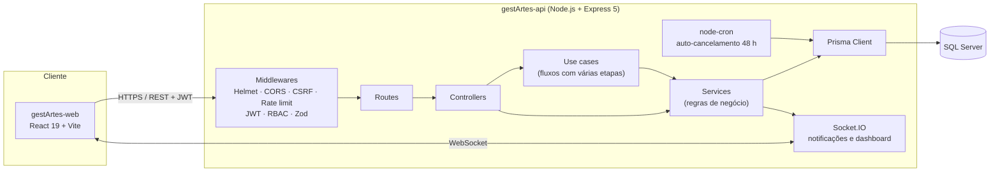
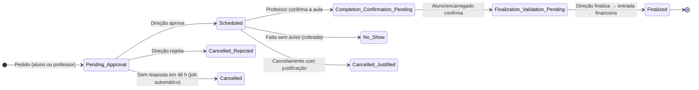

<div align="center">

# gestArtes

**Plataforma web de gestão para a Escola de Dança Ent'artes**

Coachings (aulas particulares) · Estúdios · Inventário de figurinos · Marketplace · Perdidos e Achados · Faturação


Projeto **50+10** · Licenciatura em Engenharia de Sistemas Informáticos (LESI) · IPCA · 2025/2026
Desenvolvido pela equipa **NovaLogic Systems**

</div>

---

## Índice

- [Sobre o projeto](#sobre-o-projeto)
- [Funcionalidades](#funcionalidades)
- [Arquitetura](#arquitetura)
- [Stack tecnológica](#stack-tecnológica)
- [Repositórios](#repositórios)
- [Fluxos de negócio](#fluxos-de-negócio)
- [Modelo de dados](#modelo-de-dados)
- [API REST](#api-rest)
- [Segurança](#segurança)
- [Como correr localmente](#como-correr-localmente)
- [Testes](#testes)
- [Documentação e modelação](#documentação-e-modelação)
- [Equipa](#equipa)
- [Licença](#licença)

---

## Sobre o projeto

A **Ent'artes** é uma escola de dança com cerca de **400 alunos, 51 turmas e 8 estúdios**. Para além das aulas regulares (18h00–21h30), a escola organiza **coachings** — aulas particulares, duetos, trios ou ensembles (4 a 8 alunos), com duração entre 30 e 120 minutos — marcados maioritariamente pelos encarregados de educação e validados pela Direção.

Antes do gestArtes, este processo dependia de mensagens, folhas de cálculo e verificação manual de disponibilidades. Os principais problemas identificados no levantamento de requisitos foram:

- **Conflitos de agendamento** — nem todas as modalidades cabem em todos os estúdios e um estúdio não pode estar reservado duas vezes;
- **Estúdios desaproveitados** — falta de visibilidade sobre a ocupação real;
- **Validação lenta** — os pedidos têm de ser confirmados pela Direção num prazo máximo de 48 h;
- **Faturação manual** — os coachings concluídos eram passados à mão para a contabilidade;
- **Figurinos e adereços duplicados** — compravam-se peças que já existiam na comunidade escolar.

O **gestArtes** centraliza tudo isto numa aplicação web fechada por login, com três perfis — **Aluno/Encarregado**, **Professor** e **Direção** — e regras de negócio aplicadas diretamente no backend.

---

## Funcionalidades

### Aluno / Encarregado de Educação

| Área | O que permite |
|---|---|
| **Dashboard** | KPIs pessoais, próximas sessões e ações rápidas |
| **Coaching** | Mapa semanal de vagas (professor livre + estúdio compatível livre), pedido de coaching, pedido de adesão a sessões de grupo já agendadas, cancelamento com justificação |
| **Horário** | Horário escolar e sessões futuras |
| **Histórico** | Sessões passadas e confirmação de que a aula decorreu |
| **Inventário** | Catálogo de figurinos/adereços da escola, aluguer com checkout e acompanhamento dos pedidos |
| **Marketplace** | Publicar, editar e procurar anúncios da comunidade (aluguer, venda ou doação) |
| **Perdidos e Achados** | Consulta de objetos encontrados na escola |
| **Notificações** | Centro de notificações em tempo real |
| **Conta** | Perfil, foto opcional e alteração de palavra-passe |

### Professor

| Área | O que permite |
|---|---|
| **Disponibilidade** | Submissão de disponibilidade recorrente (semestral) ou pontual e registo de ausências — sujeitas a aprovação da Direção |
| **Coaching** | Criar iniciativas de coaching (datas, estúdio, capacidade, preço), rever pedidos de alunos, propor sessões de grupo |
| **Pedidos de adesão** | 1.º nível de aprovação de alunos que pedem para entrar numa sessão |
| **Confirmação de sessões** | Confirmar a realização da aula ou registar falta sem aviso (*no-show*) |
| **Horário, inventário, marketplace, notificações e conta** | Equivalentes ao perfil de aluno, adaptados ao professor |

### Direção / Coordenação

| Área | O que permite |
|---|---|
| **Dashboard operacional** | Indicadores em tempo real (Socket.IO) sobre pedidos pendentes, sessões e ocupação |
| **Validações** | Aprovar/rejeitar pedidos de coaching, disponibilidades, ausências, pedidos de adesão e finalizar sessões concluídas |
| **Estúdios** | Gestão de estúdios, modalidades compatíveis, bloqueios e ocupação em tempo real |
| **Horários** | Gestão dos horários letivos por ano (com *seed* dos horários reais 2025/2026) |
| **Utilizadores** | CRUD de utilizadores, atribuição de vários perfis e *reset* de palavra-passe |
| **Inventário** | Gestão de artigos da escola, aprovação de alugueres e verificação do estado na devolução |
| **Marketplace** | Moderação de anúncios (aprovar, rejeitar, remover) |
| **Financeiro** | Movimentos, resumo mensal, receita e exportação CSV para a contabilidade |
| **Auditoria** | Registo de todas as ações sensíveis, com filtros e resumo |
| **Perdidos e Achados** | Registo, reclamação e arquivo de objetos |
| **Notificações** | Envio de avisos gerais ou dirigidos (*broadcast* por perfil) |

> Um utilizador pode ter **vários perfis** (por exemplo, professor e direção) e alternar entre eles sem terminar sessão.

---

## Arquitetura



**Backend** organizado em camadas: as rotas só fazem *routing* e validação, os *controllers* tratam do pedido HTTP, os *services* contêm as regras de negócio e os *use cases* (`src/application/use-cases/`) orquestram fluxos com várias etapas e transações (aprovação de sessões, alugueres, pedidos de adesão, etc.).

**Frontend** em React com rotas protegidas por perfil (`ProtectedRoute`, `WithRole`), um cliente Axios com renovação automática do *access token* e uma biblioteca própria de componentes UI (`Button`, `Modal`, `Table`, `KPICard`, `Pagination`, `Toast`, …).

---

## Stack tecnológica

| Camada | Tecnologias |
|---|---|
| **Backend** | Node.js, Express 5, Prisma 7 (`@prisma/adapter-mssql`), SQL Server |
| **Validação** | Zod, express-validator |
| **Autenticação** | JWT (access + refresh token), bcrypt |
| **Segurança** | Helmet (CSP com *nonce*), CORS por *allow-list*, proteção CSRF por origem, express-rate-limit |
| **Tempo real** | Socket.IO |
| **Tarefas agendadas** | node-cron |
| **Uploads** | Multer (fotos de inventário e marketplace) |
| **Logs** | Winston (ficheiro) + Morgan (HTTP) |
| **Documentação API** | Swagger / OpenAPI 3 (`swagger-jsdoc`, `swagger-ui-express`) |
| **Frontend** | React 19, React Router 7, Axios, Recharts, React Icons, react-hot-toast, socket.io-client |
| **Testes** | Jest + Supertest, `node --test` (API) · Vitest + Testing Library (web) |
| **Modelação** | Visual Paradigm, BPMN, Mermaid, LaTeX |

---

## Repositórios

O projeto está dividido em três repositórios na organização [NovaLogic-Systems](https://github.com/NovaLogic-Systems):

| Repositório | Conteúdo |
|---|---|
| [`gestArtes-api`](https://github.com/NovaLogic-Systems/gestArtes-api) | API REST, base de dados (Prisma), WebSockets, jobs e testes |
| [`gestArtes-web`](https://github.com/NovaLogic-Systems/gestArtes-web) | Aplicação web React |
| [`gestArtes-docs`](https://github.com/NovaLogic-Systems/gestArtes-docs) | Requisitos, regras de negócio, *user stories* e diagramas |

Para trabalhar com todos ao mesmo tempo, clona-os para a mesma pasta:

```text
gestArtes/
├── gestArtes-api/
├── gestArtes-web/
└── gestArtes-docs/
```

<details>
<summary><b>Estrutura do <code>gestArtes-api</code></b></summary>

```text
gestArtes-api/
├── prisma/
│   ├── schema.prisma            # 56 modelos — fonte de verdade da BD
│   ├── migrations/              # migrações incrementais
│   ├── sql/                     # full-text indexes, stored procedures e seeds SQL
│   └── seed-entartes-timetables.js
├── src/
│   ├── app.js                   # entry point (Express + HTTP/HTTPS + Socket.IO)
│   ├── socket.js                # salas por utilizador e broadcast por perfil
│   ├── application/use-cases/   # fluxos de negócio com várias etapas
│   ├── controllers/
│   ├── services/                # regras de negócio (pricing, coaching, finance, …)
│   ├── routes/
│   ├── middlewares/             # auth, rbac, csrf, rate limit, uploads, schemas Zod
│   ├── jobs/autoCancel.js       # cancela pedidos sem resposta ao fim de 48 h
│   ├── events/
│   ├── config/                  # Prisma e Swagger
│   └── utils/                   # logger, auditoria, CSV, datas, perfis
├── server/tests/                # testes Jest + Supertest
└── test/                        # testes unitários e de integração (node --test)
```

</details>

<details>
<summary><b>Estrutura do <code>gestArtes-web</code></b></summary>

```text
gestArtes-web/src/
├── App.jsx                # router com rotas por perfil
├── components/
│   ├── ui/                # biblioteca de componentes base
│   ├── layout/            # Sidebar e Topbar
│   ├── admin/ teacher/    # componentes específicos de cada perfil
│   └── ProtectedRoute.jsx, WithRole.jsx, RoleSwitcher.jsx, NotificationsBell.jsx
├── context/               # AuthContext (sessão, perfis, socket)
├── hooks/                 # useAuth, useDebounce
├── pages/
│   ├── student/           # 14 páginas
│   ├── teacher/           # 12 páginas
│   └── admin/             # 13 páginas
├── services/              # um módulo por domínio + api.js (Axios) + tokenStore
└── utils/
```

</details>

---

## Fluxos de negócio

### Ciclo de vida de uma sessão de coaching



Antes da aprovação, o sistema verifica **disponibilidade do professor** (já aprovada pela Direção), **estúdio livre** e **compatibilidade estúdio ↔ modalidade**. Depois da finalização, a sessão gera automaticamente uma **entrada financeira** que alimenta o **resumo mensal** exportado para a contabilidade.

### Outros fluxos

- **Adesão a sessão existente** — o aluno pede para entrar numa sessão com vagas → aprovação do professor → validação final da Direção (dupla aprovação).
- **Disponibilidade de professores** — submetida pelo professor e só visível para marcação depois de aprovada pela Direção.
- **Aluguer de inventário da escola** — pedido → aprovação → entrega → **verificação do estado e da data de devolução** (aceite ou rejeitada).
- **Marketplace** — anúncio criado por aluno ou professor → moderação da Direção → publicado.

### Preços

| Regra | Valor |
|---|---|
| Preço base de coaching | **36 €/hora** (configurável em `SessionPricingRate`) |
| Fora do horário normal (ex.: domingo) | ×1,5 |
| Falta sem aviso | Sessão cobrada na mesma |

O sistema **não fatura diretamente**: gera tabelas-resumo (CSV) que a escola passa ao seu sistema de faturação.

As 31 regras de negócio completas estão em [`requirements/BusinessRules.md`](requirements/BusinessRules.md).

---

## Modelo de dados

A base de dados é **SQL Server**, gerida com **Prisma**. O `schema.prisma` tem **56 modelos**, agrupados por domínio:

| Domínio | Modelos principais |
|---|---|
| **Utilizadores e acesso** | `User`, `Role`, `UserRole`, `RefreshToken`, `StudentAccount`, `StudentAllowedModality` |
| **Coaching** | `CoachingSession`, `CoachingRequest`, `CoachingRequestAction`, `CoachingJoinRequest`, `GroupCoachingProposal`, `SessionStudent`, `SessionTeacher`, `SessionStatus`, `SessionValidation`, `ValidationStep` |
| **Professores** | `TeacherAvailability` (recorrente/pontual), `TeacherAbsence`, `TeacherModality` |
| **Estúdios e horários** | `Studio`, `StudioModality`, `StudioBlock`, `StudioStatusOverride`, `Modality`, `AcademicYear`, `Timetable`, `TimetableSlot`, `SchoolSchedule` |
| **Inventário e marketplace** | `InventoryItem`, `InventoryTransaction`, `ItemCategory`, `MarketplaceItem`, `MarketplaceTransaction` |
| **Financeiro** | `SessionPricingRate`, `FinancialEntry`, `FinancialSummary`, `PaymentMethod` |
| **Outros** | `Notification`, `NotificationType`, `AuditLog`, `LostAndFoundItem`, `SchoolEvent` |

Para além das migrações, `prisma/sql/` contém **índices full-text** (pesquisa no marketplace e inventário) e **stored procedures** de desempenho.

---

## API REST

Todas as rotas (exceto `/health`, `/auth/login` e `/auth/refresh`) exigem `Authorization: Bearer <access_token>` e são protegidas por perfil. A documentação interativa está em **`/docs`** (Swagger UI) quando a API está a correr.

| Grupo | Prefixo | Exemplos |
|---|---|---|
| Autenticação | `/auth` | `POST /login`, `POST /refresh`, `POST /logout`, `POST /logout-all`, `GET /me`, `POST /switch-role` |
| Aluno | `/student` | `GET /dashboard`, `GET /schedule/upcoming`, `GET/PATCH /profile` |
| Professor | `/teacher` | `GET /dashboard`, `POST /availability/submit`, `GET /calendar`, `PATCH /sessions/:id/confirm-completion`, `POST /sessions/:id/no-show` |
| Coaching | `/coaching` | `GET /weekly-map`, `GET /slots`, `POST /requests`, `PATCH /requests/:id/admin-review`, `POST /group-proposals` |
| Pedidos de adesão | `/coaching/join-requests` | `PATCH /:id/teacher-approve`, `PATCH /admin/coaching/join-requests/:id/approve` |
| Inventário | `/inventory` | `GET /items`, `POST /rentals`, `GET /rentals` |
| Marketplace | `/marketplace` | `GET /listings`, `POST /listings`, `GET /my-listings` |
| Perdidos e Achados | `/lostfound` | `GET /lostfound`, `PATCH /admin/lostfound/:id/claim` |
| Notificações | `/notifications` | `GET /`, `PATCH /:id/read`, `POST /broadcast` |
| Horários | `/timetables` | CRUD de horários e *slots* |
| Direção | `/admin` | `GET /dashboard`, `/users`, `/validations/*`, `/studios`, `/studio-occupancy`, `/inventory`, `/marketplace/listings`, `/finance/*`, `/audit` |

**Eventos Socket.IO** — cada utilizador entra numa sala `user:<id>` e nas salas de *broadcast* do seu perfil. Eventos emitidos: `notification`, `availability:changed`, `availability:summary` e atualizações do dashboard da Direção.

---

## Segurança

- **JWT com dois tokens**: *access token* de curta duração (15 min), renovado automaticamente pelo cliente, e *refresh token* (7 dias) num **cookie `httpOnly`**, guardado na BD (`RefreshToken`) para permitir revogação e `logout-all`.
- **RBAC** por perfil e por permissão (`rbac.middleware.js`), aplicado em todas as rotas.
- **Palavras-passe** com `bcrypt`.
- **Helmet** com Content-Security-Policy por *nonce*, `frame-ancestors 'none'`, `no-referrer` e HSTS em produção.
- **CORS** por *allow-list* e **proteção CSRF** por validação de `Origin`/`Referer` em pedidos que alteram estado.
- **Rate limiting** global, específico para *polling* de notificações e mais restritivo no login (configurável por `.env`).
- **Validação de input** com schemas Zod em todos os *endpoints* de escrita.
- **HTTPS** nativo (com redirecionamento HTTP → HTTPS em produção).
- **Auditoria** persistida em BD (`AuditLog`) para ações sensíveis.

---

## Como correr localmente

### Pré-requisitos

- **Node.js** `^20.19.0` ou `>=22.12.0`
- **SQL Server** (local, Docker ou remoto)
- **OpenSSL** (opcional, só se quiseres HTTPS em desenvolvimento)

### 1. Clonar os repositórios

```bash
mkdir gestArtes && cd gestArtes
git clone https://github.com/NovaLogic-Systems/gestArtes-api.git
git clone https://github.com/NovaLogic-Systems/gestArtes-web.git
git clone https://github.com/NovaLogic-Systems/gestArtes-docs.git
```

### 2. Backend (`gestArtes-api`)

```bash
cd gestArtes-api
npm install
cp .env.example .env
```

Variáveis mais importantes no `.env`:

| Variável | Descrição |
|---|---|
| `DATABASE_URL` | Ligação ao SQL Server (`sqlserver://HOST:1433;database=...;user=...;password=...;encrypt=true;trustServerCertificate=true;`) |
| `PORT` | Porta da API (por omissão `3001`) |
| `CLIENT_URL` / `CORS_ORIGINS` | Origem(ns) do frontend, ex.: `https://localhost:3000` |
| `JWT_ACCESS_SECRET` / `JWT_REFRESH_SECRET` | Segredos **diferentes** para cada token |
| `ENABLE_HTTPS` | `false` para correr só em HTTP (mais simples para Postman) |
| `SSL_KEY_PATH` / `SSL_CERT_PATH` | Certificado para HTTPS (pasta `certs/`, ignorada pelo git) |
| `ENABLE_JOBS` | `true` para ativar o auto-cancelamento de pedidos com mais de 48 h |

Para HTTPS local, gera um certificado autoassinado:

```bash
mkdir certs
openssl req -x509 -newkey rsa:2048 -nodes -days 365 -subj "/CN=localhost" -keyout certs/gestartes.key -out certs/gestartes.crt
```

Preparar a base de dados:

```bash
npm run prisma:generate
npm run prisma:migrate:deploy
npm run prisma:seed:entartes
```

> As migrações são incrementais sobre a BD partilhada do projeto. Numa base de dados **vazia**, cria primeiro as tabelas a partir do schema com `npx prisma db push` e depois executa os scripts de `prisma/sql/` (índices, stored procedures e dados de referência).

Arrancar:

```bash
npm run dev
```

A API fica disponível em `https://localhost:3001` (ou `http://` com `ENABLE_HTTPS=false`) e o Swagger em `/docs`.

### 3. Frontend (`gestArtes-web`)

```bash
cd ../gestArtes-web
npm install
cp .env.example .env
```

| Variável | Descrição |
|---|---|
| `VITE_API_URL` | URL da API (também usada como alvo do proxy `/api` do Vite) |
| `VITE_SOCKET_URL` | URL do servidor Socket.IO (normalmente igual à API) |
| `VITE_ENABLE_HTTPS` | `true` para servir o Vite em HTTPS com o mesmo certificado da API |
| `VITE_SSL_KEY_PATH` / `VITE_SSL_CERT_PATH` | Caminho para o certificado (ex.: `../gestArtes-api/certs/gestartes.key`) |

```bash
npm run dev
```

A aplicação fica disponível em **`https://localhost:3000`** (ou `http://` sem certificado).

> No PowerShell, se o `npm` estiver bloqueado pela política de execução, usa `npm.cmd`.

### Scripts disponíveis

<details>
<summary><b>gestArtes-api</b></summary>

| Script | Descrição |
|---|---|
| `npm run dev` | Arranca com *hot reload* (nodemon) |
| `npm start` | Arranca em modo produção |
| `npm test` | Testes Jest com cobertura |
| `npm run test:node:unit` | Testes unitários (`node --test`) |
| `npm run test:node:integration` | Testes de integração contra a BD |
| `npm run prisma:generate` | Gera o Prisma Client |
| `npm run prisma:migrate:dev` | Cria/aplica migrações em desenvolvimento |
| `npm run prisma:migrate:deploy` | Aplica migrações pendentes |
| `npm run prisma:migrate:status` | Estado das migrações |
| `npm run prisma:seed:entartes` | Carrega os horários reais da Ent'artes 2025/2026 |

</details>

<details>
<summary><b>gestArtes-web</b></summary>

| Script | Descrição |
|---|---|
| `npm run dev` | Servidor de desenvolvimento Vite |
| `npm run build` | *Build* de produção para `dist/` |
| `npm run preview` | Pré-visualiza o *build* |
| `npm run lint` | ESLint |
| `npm test` | Testes Vitest |

</details>

---

## Testes

**API**

```bash
npm test                         # Jest + Supertest (auth, coaching, pricing, confirmação de sessões)
npm run test:node:unit           # testes unitários de services, controllers e use cases
npm run test:node:integration    # testes de integração (requer BD configurada)
```

Os testes de integração cobrem os principais fluxos (dashboard da Direção, sessões, pesquisa de disponibilidade, inventário, marketplace, perdidos e achados, notificações, admissões) e um conjunto de **testes de segurança** (CORS, CSRF, cabeçalhos, autenticação).

**Web**

```bash
npm test     # Vitest + Testing Library (componentes UI, hooks, rotas protegidas, utilitários)
```

---

## Documentação e modelação

Este repositório reúne toda a análise do sistema:

| Artefacto | Localização |
|---|---|
| Levantamento de requisitos com a escola | [`Entartes.md`](Entartes.md) |
| Regras de negócio (BR-01 a BR-31) | [`requirements/BusinessRules.md`](requirements/BusinessRules.md) |
| *User stories* | [`requirements/UserStories.md`](requirements/UserStories.md) |
| Requisitos não funcionais | [`requirements/RNF-NonFunctionalRequirementsFinal.tex`](requirements/RNF-NonFunctionalRequirementsFinal.tex) |
| Stakeholders | [`Stakeholders/`](Stakeholders) |
| Casos de uso | [`diagrams/Use Case/`](<diagrams/Use Case>) |
| Processos BPMN (coaching, validação, aluguer, disponibilidade, marketplace, adesão a sessões) | [`diagrams/BPMN/`](diagrams/BPMN) |
| Diagrama de classes | [`diagrams/Class Diagram/`](<diagrams/Class Diagram>) |
| Diagramas de sequência | [`diagrams/Sequence Diagram/`](<diagrams/Sequence Diagram>) |
| Máquina de estados das sessões | [`diagrams/State Machine Diagram/`](<diagrams/State Machine Diagram>) |
| Diagrama de atividades | [`diagrams/ACT/`](diagrams/ACT) |
| ERD | [`diagrams/ERD/`](diagrams/ERD) |
| Mapa do site | [`diagrams/Sitemap/`](diagrams/Sitemap) |
| Relatório da Milestone | [`milestones/`](milestones) |

O desenvolvimento foi gerido com **GitHub Issues** (templates de *user story*, tarefa técnica e *bug report*) e **pull requests** com revisão.

---

## Equipa

**NovaLogic Systems**

| Nº | Nome | GitHub |
|---|---|---|
| 31500 | Afonso Miguel Carneiro Corte Real | [@afonsocortereal15](https://github.com/afonsocortereal15) |
| 31499 | Alexandre Magalhães Martins Machado | [@alequece2](https://github.com/alequece2) |
| 31027 | Fernando Manuel Queirós Pinto Coelho | [@nandocoelho](https://github.com/nandocoelho) |
| 31497 | Pedro Filipe Martins Andrade | [@MasterZeroPT](https://github.com/MasterZeroPT) |
| 31502 | Rodrigo Henrique Silva Pinheiro | [@rpinheiror](https://github.com/rpinheiror) |

**Unidade curricular:** Projeto de Desenvolvimento de Software (Projeto 50+10) · **Docente:** Nuno Rodrigues
Licenciatura em Engenharia de Sistemas Informáticos · Escola Superior de Tecnologia · Instituto Politécnico do Cávado e do Ave (IPCA) · 2025/2026

Projeto desenvolvido para a **Escola de Dança Ent'artes**.

---

## Licença

Distribuído sob a licença **MIT**. Ver [`LICENSE`](LICENSE).
